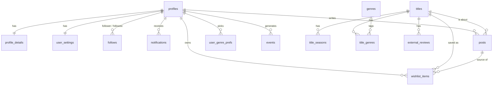

# 02 — Architecture & Data Model

> Status: **SPEC v1 — APPROVED 2026-11-01** · Rules in `00-rules-source-of-truth.md` override this document.

---

## 1. External data sources

Both APIs are listed in the **Video** section of [public-apis/public-apis](https://github.com/public-apis/public-apis).

| Source | Role | What we use | Key |
|---|---|---|---|
| **TMDB** (primary) | Catalogue + Discover | Search (he/en), movie & series details, **Hebrew + English titles and summaries**, genres, posters, **season details** (summary, poster, air date), trending, top rated, recommendations, **external reviews**, IMDb id | free API key, backend only |
| **OMDb** (secondary) | Official ratings | By IMDb id: **IMDb rating & votes, Rotten Tomatoes, Metacritic** | free key (1,000 calls/day), backend only |

**Why two APIs (conflict C1):** OMDb can only look up known titles, so it cannot power Discover or Hebrew summaries. TMDB covers both. OMDb adds the ratings people recognise (IMDb, RT, Metacritic).

**TMDB calls (exact parameters confirmed in Phase 1):**

| Call | Purpose |
|---|---|
| `search/multi?query=&language=he-IL\|en-US` | Search for the post composer |
| `movie/{id}`, `tv/{id}` with `append_to_response=external_ids` (run once per language) | Title details + IMDb id |
| `tv/{id}/season/{n}` | Season summary and poster for season posts |
| `trending/{movie\|tv}/week`, `movie/top_rated`, `tv/top_rated` | Discover lists |
| `{movie\|tv}/{id}/recommendations` | "Because you liked X" |
| `{movie\|tv}/{id}/reviews` | External reviews; we store a ≤ 300-char excerpt + link + author + "on TMDB" |

**OMDb call:** `?i={imdb_id}` → `imdbRating`, `imdbVotes`, `Ratings[]` (Rotten Tomatoes, Metacritic).

**Caching:**

| Data | Refresh / limit |
|---|---|
| Title rows | Refreshed after 30 days |
| Discover lists | Cached 6 hours, per language |
| Reviews | Cached 7 days |

API keys never reach the browser.

**Hebrew fallback:** many TMDB titles have no Hebrew summary. The UI then shows the English one with a small "English" label.

**Attribution (required by TMDB):**
- The TMDB logo and the notice "This product uses the TMDB API but is not endorsed or certified by TMDB" go in Settings → About.
- Every external rating and review shows its source inline (rule R4.2).

**Licensing note for the future product (D0):**
- TMDB is free for non-commercial use. A revenue-generating app needs a TMDB commercial license.
- Re-check OMDb's terms at the same time.

## 2. Stack

| Layer | Choice |
|---|---|
| Frontend | React + Vite + TypeScript, Tailwind (with RTL support), react-i18next, supabase-js (sign-in only) |
| Backend | Python **FastAPI**, SQLAlchemy Core + hand-written SQL (you learn the SQL), httpx for the external APIs |
| Database | **PostgreSQL on Supabase**: tables in schema `app`, not exposed through Supabase's auto-generated Data API |
| Auth | **Supabase Auth**: email + password (with email confirmation) **and** Google sign-in. FastAPI verifies the Supabase JWT and uses its `sub` as the user id. |
| Migrations | Plain SQL files with the Supabase CLI (`supabase/migrations/*.sql`): tables, RLS policies and triggers, all in SQL |
| Analysis | Jupyter + pandas against a local copy with fake data |
| CI | GitHub Actions: lint, unit tests, integration tests against a local Supabase stack |

## 3. Hosting & Claude tooling

| Where | What | Free-tier notes |
|---|---|---|
| **Local** (until Phase 8) | `supabase start` (local Postgres + Auth in Docker), `uvicorn` for FastAPI, `vite` for React | Same database and auth as production |
| **Supabase** | Postgres + Auth | 2 active projects, 500 MB DB, 50k monthly users, Google sign-in included. A project **pauses after 1 week without activity** (one click to resume). |
| **Render** | FastAPI (web service) + React (static site), auto-deploy on `git push` | The free web service **sleeps after 15 min** idle; the first request takes about a minute. Don't use Render's free Postgres: it is **deleted after 30 days**. |

**Working with Claude:**
- **Supabase MCP** (official, hosted): run it in *read-only* and *project-scoped* mode, and point it at the dev project. Supabase advises against connecting it to production.
- **Render MCP** (official, GA since Aug 2025): creates services, reads logs and metrics, and lists deploy history.
- The Supabase CLI handles migrations and the local stack. Deploys happen through git.

## 4. Components

```
┌──────────── React web app (he/en, RTL-aware) ─────────────┐
│ Home · Discover · Post · Wishlist · Profile · Notifications │
│ Title page · Onboarding · My Stats · Settings               │
└──────┬──────────────────────────────────────┬──────────────┘
       │ sign-in (supabase-js)                │ JSON + Bearer JWT
┌──────▼──────┐   ┌───────────────────────────▼──────────────────────┐
│Supabase Auth│   │ FastAPI                                           │
└─────────────┘   │  deps/user_db   – opens a DB transaction AS USER  │
                  │  catalog/       – TitleService ─► tmdb_client     │
                  │                                ─► omdb_client     │
                  │  discover/      – lists, recs, external reviews   │
                  │  posts/ feed/   – compose, edit, home feed        │
                  │  follows/       – request/accept/decline/remove   │
                  │  notifications/ – list, mark read                 │
                  │  wishlist/      – owner-only CRUD                 │
                  │  taste/         – pure scoring + SQL loaders      │
                  │  stats/  events/                                   │
                  └──────────────┬────────────────────────────────────┘
                                 │ user-scoped session (RLS on)
                                 │ service session (catalogue writes only)
                  ┌──────────────▼──────────────┐
                  │ Supabase Postgres — schema app│◄── Jupyter (local, fake data)
                  └─────────────────────────────┘
```

- `tmdb_client` and `omdb_client` know nothing about users.
- `taste` is pure functions plus two SQL loaders, so it is unit-testable.
- Only `catalog` and `discover` use the **service session**. They write to catalogue tables only, never user content.

## 5. Privacy enforcement (rule R5)

1. **RLS is on for every table.** User-content policies are written against `auth.uid()`.
2. **Every API request runs as the user.** A FastAPI dependency opens a transaction and runs:

   ```sql
   SET LOCAL ROLE authenticated;
   SELECT set_config('request.jwt.claims', :verified_claims_json, true);
   ```

   Every query in that request is then filtered by the database itself. A forgotten `WHERE` in Python cannot leak a private post.
3. **Invisible means 404.** An endpoint that finds no row returns 404, whether the row is missing or hidden.
4. **Tables live in schema `app`**, not exposed through Supabase's Data API. Even with the browser's public key, nobody can query them directly. RLS is the second lock.
5. **Tests** (see §8) check the full visibility matrix from `00` with three users:
   - **Gal**, the owner.
   - **Dana**, an approved follower.
   - **Noa**, a stranger.

## 6. Database schema (v1)



```sql
CREATE SCHEMA app;

-- ===== People =====================================================
-- Card: the ONLY fields any signed-in user may see (rule R1.2)
CREATE TABLE app.profiles (
    id            UUID PRIMARY KEY REFERENCES auth.users(id) ON DELETE CASCADE,
    username      TEXT UNIQUE NOT NULL CHECK (username ~ '^[a-z0-9_.]{3,30}$'),
    display_name  TEXT NOT NULL,
    avatar_url    TEXT,
    created_at    TIMESTAMPTZ NOT NULL DEFAULT now()
);
-- Followers-only details
CREATE TABLE app.profile_details (
    user_id UUID PRIMARY KEY REFERENCES app.profiles(id) ON DELETE CASCADE,
    bio     TEXT CHECK (char_length(bio) <= 300)
);
-- Owner-only settings
CREATE TABLE app.user_settings (
    user_id UUID PRIMARY KEY REFERENCES app.profiles(id) ON DELETE CASCADE,
    locale  TEXT NOT NULL DEFAULT 'he' CHECK (locale IN ('he','en'))
);

-- One-way follow, approval required (rule R2)
CREATE TABLE app.follows (
    follower_id  UUID NOT NULL REFERENCES app.profiles(id) ON DELETE CASCADE,
    followee_id  UUID NOT NULL REFERENCES app.profiles(id) ON DELETE CASCADE,
    status       TEXT NOT NULL DEFAULT 'pending' CHECK (status IN ('pending','accepted')),
    created_at   TIMESTAMPTZ NOT NULL DEFAULT now(),
    responded_at TIMESTAMPTZ,
    PRIMARY KEY (follower_id, followee_id),
    CHECK (follower_id <> followee_id)
);
-- decline / cancel / unfollow / remove follower = DELETE the row

CREATE TABLE app.notifications (
    id           BIGSERIAL PRIMARY KEY,
    recipient_id UUID NOT NULL REFERENCES app.profiles(id) ON DELETE CASCADE,
    actor_id     UUID NOT NULL REFERENCES app.profiles(id) ON DELETE CASCADE,
    type         TEXT NOT NULL CHECK (type IN ('follow_request','follow_accepted')),
    read_at      TIMESTAMPTZ,
    created_at   TIMESTAMPTZ NOT NULL DEFAULT now()
);
-- filled by triggers on app.follows (INSERT → follow_request, UPDATE to accepted → follow_accepted);
-- a request's notification is deleted if the request is cancelled or declined

-- ===== Catalogue (external, cached) ===============================
CREATE TABLE app.titles (
    id            BIGSERIAL PRIMARY KEY,
    tmdb_id       INTEGER NOT NULL,
    media_type    TEXT NOT NULL CHECK (media_type IN ('movie','series')),
    imdb_id       TEXT UNIQUE,
    name_en       TEXT NOT NULL,
    name_he       TEXT,
    overview_en   TEXT,
    overview_he   TEXT,
    year_start    SMALLINT,
    year_end      SMALLINT,
    runtime_min   INTEGER,
    season_count  SMALLINT,
    poster_path   TEXT,
    imdb_rating   NUMERIC(3,1),
    imdb_votes    INTEGER,
    rt_score      SMALLINT,           -- Rotten Tomatoes %
    metacritic    SMALLINT,
    tmdb_rating   NUMERIC(3,1),
    raw_tmdb      JSONB NOT NULL,
    raw_omdb      JSONB,
    fetched_at    TIMESTAMPTZ NOT NULL DEFAULT now(),
    UNIQUE (tmdb_id, media_type)
);
CREATE TABLE app.title_seasons (
    title_id      BIGINT REFERENCES app.titles(id) ON DELETE CASCADE,
    season_number SMALLINT CHECK (season_number >= 1),
    name_en TEXT, name_he TEXT, overview_en TEXT, overview_he TEXT,
    poster_path TEXT, air_date DATE, episode_count SMALLINT,
    PRIMARY KEY (title_id, season_number)
);
CREATE TABLE app.genres (id INTEGER PRIMARY KEY, name_en TEXT NOT NULL, name_he TEXT); -- TMDB genre ids
CREATE TABLE app.title_genres (
    title_id BIGINT REFERENCES app.titles(id) ON DELETE CASCADE,
    genre_id INTEGER REFERENCES app.genres(id),
    PRIMARY KEY (title_id, genre_id)
);
CREATE TABLE app.external_reviews (
    id               BIGSERIAL PRIMARY KEY,
    title_id         BIGINT NOT NULL REFERENCES app.titles(id) ON DELETE CASCADE,
    source           TEXT NOT NULL DEFAULT 'tmdb',
    source_review_id TEXT NOT NULL,
    author_name      TEXT NOT NULL,         -- shown as "Review by <author> on TMDB"
    excerpt          TEXT NOT NULL CHECK (char_length(excerpt) <= 300),
    url              TEXT NOT NULL,
    author_rating    NUMERIC(3,1),
    language         TEXT,
    fetched_at       TIMESTAMPTZ NOT NULL DEFAULT now(),
    UNIQUE (source, source_review_id)
);
CREATE TABLE app.discover_cache (
    list_key   TEXT,                       -- 'trending:movie:week', 'recs:movie:603'
    locale     TEXT,
    payload    JSONB NOT NULL,
    fetched_at TIMESTAMPTZ NOT NULL DEFAULT now(),
    PRIMARY KEY (list_key, locale)
);

-- ===== User content ==============================================
CREATE TABLE app.posts (
    id                BIGSERIAL PRIMARY KEY,
    author_id         UUID NOT NULL REFERENCES app.profiles(id) ON DELETE CASCADE,
    title_id          BIGINT NOT NULL REFERENCES app.titles(id),
    season_number     SMALLINT NOT NULL DEFAULT 0,      -- 0 = whole movie / whole series
    rating            NUMERIC(3,1) NOT NULL
                      CHECK (rating BETWEEN 1 AND 10 AND rating * 2 = round(rating * 2)),  -- ½ steps
    opinion           TEXT CHECK (char_length(opinion) <= 500),
    contains_spoilers BOOLEAN NOT NULL DEFAULT false,
    is_shared         BOOLEAN NOT NULL DEFAULT true,    -- false = private rating (owner only)
    created_at        TIMESTAMPTZ NOT NULL DEFAULT now(),
    updated_at        TIMESTAMPTZ NOT NULL DEFAULT now(),
    UNIQUE (author_id, title_id, season_number)
);
-- app check (in a trigger): season_number > 0 only for series and must exist in title_seasons
CREATE INDEX posts_feed_idx ON app.posts (author_id, created_at DESC) WHERE is_shared;

CREATE TABLE app.wishlist_items (
    owner_id       UUID NOT NULL REFERENCES app.profiles(id) ON DELETE CASCADE,
    title_id       BIGINT NOT NULL REFERENCES app.titles(id),
    source         TEXT NOT NULL CHECK (source IN ('post','discover','search')),
    source_post_id BIGINT REFERENCES app.posts(id) ON DELETE SET NULL,
    status         TEXT NOT NULL DEFAULT 'want' CHECK (status IN ('want','watched','dropped')),
    fit_at_save    SMALLINT,                 -- Taste Match % when saved (for evaluation)
    added_at       TIMESTAMPTZ NOT NULL DEFAULT now(),
    watched_at     TIMESTAMPTZ,
    PRIMARY KEY (owner_id, title_id)
);

CREATE TABLE app.user_genre_prefs (
    user_id  UUID REFERENCES app.profiles(id) ON DELETE CASCADE,
    genre_id INTEGER REFERENCES app.genres(id),
    PRIMARY KEY (user_id, genre_id)
);

CREATE TABLE app.events (                    -- append-only analytics log, owner-only rows
    id         BIGSERIAL PRIMARY KEY,
    user_id    UUID REFERENCES app.profiles(id) ON DELETE CASCADE,
    event_type TEXT NOT NULL,   -- post_created, post_viewed, saved, watched, follow_requested, discover_opened, ...
    title_id   BIGINT,
    post_id    BIGINT,
    props      JSONB,           -- e.g. {"fit": 87, "surface": "home"}
    created_at TIMESTAMPTZ NOT NULL DEFAULT now()
);
```

### RLS policies (essentials)

```sql
ALTER TABLE app.posts ENABLE ROW LEVEL SECURITY;   -- … and every other table

-- helper: is the current user an APPROVED follower of :target?
CREATE FUNCTION app.follows_approved(target UUID) RETURNS BOOLEAN
LANGUAGE sql STABLE AS $$
  SELECT EXISTS (SELECT 1 FROM app.follows
                 WHERE follower_id = auth.uid() AND followee_id = target AND status = 'accepted')
$$;

-- profiles (card): any signed-in user may read; only owner may write
CREATE POLICY card_read  ON app.profiles FOR SELECT TO authenticated USING (true);
CREATE POLICY card_write ON app.profiles FOR UPDATE TO authenticated USING (id = auth.uid());

-- profile_details: owner or approved follower
CREATE POLICY details_read ON app.profile_details FOR SELECT TO authenticated
  USING (user_id = auth.uid() OR app.follows_approved(user_id));

-- posts: owner sees all of theirs; approved followers see SHARED posts only
CREATE POLICY posts_read ON app.posts FOR SELECT TO authenticated
  USING (author_id = auth.uid() OR (is_shared AND app.follows_approved(author_id)));
CREATE POLICY posts_write ON app.posts FOR ALL TO authenticated
  USING (author_id = auth.uid()) WITH CHECK (author_id = auth.uid());

-- follows: only the two people involved can see a row
CREATE POLICY follows_read    ON app.follows FOR SELECT TO authenticated
  USING (auth.uid() IN (follower_id, followee_id));
CREATE POLICY follows_request ON app.follows FOR INSERT TO authenticated
  WITH CHECK (follower_id = auth.uid() AND status = 'pending');
CREATE POLICY follows_accept  ON app.follows FOR UPDATE TO authenticated
  USING (followee_id = auth.uid()) WITH CHECK (status = 'accepted');
CREATE POLICY follows_delete  ON app.follows FOR DELETE TO authenticated
  USING (auth.uid() IN (follower_id, followee_id));   -- unfollow / cancel / decline / remove

-- wishlist, settings, notifications, events, genre prefs: owner only
CREATE POLICY wishlist_owner ON app.wishlist_items FOR ALL TO authenticated
  USING (owner_id = auth.uid()) WITH CHECK (owner_id = auth.uid());
CREATE POLICY notif_owner ON app.notifications FOR SELECT TO authenticated USING (recipient_id = auth.uid());
-- (same owner-only pattern for user_settings, user_genre_prefs, events)

-- catalogue tables: read for all signed-in users, no write policy (service session only)
CREATE POLICY catalog_read ON app.titles FOR SELECT TO authenticated USING (true);
```

**Notes**
- Follower/following **lists** are visible only to the owner, through the follows read policy. Post count needs no special rule: a count over `posts` already sees only what RLS allows.
- A wishlist item's "via Gal" link joins to `posts` under RLS. If Gal later removes you as a follower, the item stays in your wishlist but the link disappears.
- Taste Match only ever reads posts the viewer can already see (see `03`).

### Key queries

```sql
-- Home feed (runs as the user; RLS already limits rows)
SELECT p.*, t.name_he, t.name_en, t.poster_path, t.imdb_rating, pr.display_name, pr.avatar_url
FROM app.posts p
JOIN app.titles   t  ON t.id = p.title_id
JOIN app.profiles pr ON pr.id = p.author_id
WHERE p.is_shared
ORDER BY p.created_at DESC, p.id DESC
LIMIT 20;                       -- keyset pagination: AND (p.created_at, p.id) < (:c_at, :c_id)
```

## 7. API endpoints (v1)

| Method & path | Purpose | Visibility |
|---|---|---|
| `GET /me` · `PATCH /me` | Own profile, settings, language | owner |
| `GET /users/search?q=` | Find people (card fields only) | any signed-in |
| `GET /users/{username}` | Card, plus details if allowed; includes follow state | rule R1 |
| `GET /users/{username}/posts` | Profile posts | owner / approved follower, else 404 |
| `POST /follows/{username}` · `DELETE /follows/{username}` | Request (or cancel) / unfollow | follower |
| `POST /follow-requests/{username}/accept` · `DELETE /follow-requests/{username}` | Accept / decline | followee |
| `DELETE /followers/{username}` | Remove a follower | followee |
| `GET /me/followers` · `GET /me/following` · `GET /me/follow-requests` | Lists | owner |
| `GET /notifications` · `POST /notifications/read` | Bell | recipient |
| `GET /titles/search?q=&type=` | Catalogue search (TMDB, he/en) | any signed-in |
| `GET /titles/{id}` | External details + ratings + attributed reviews + **visible** followed posts | any signed-in |
| `POST /posts` · `PATCH /posts/{id}` · `DELETE /posts/{id}` | Compose / edit / delete (`season_number`, `rating` in ½ steps, `is_shared`) | author |
| `GET /feed?type=&cursor=` | Home feed with Taste Match per post | signed-in |
| `GET /discover?section=&type=&genre=` | External lists with Taste Match | any signed-in |
| `GET/POST/PATCH/DELETE /wishlist` | Private wishlist | owner |
| `GET /me/stats` | My Stats | owner |
| `POST /onboarding` | Genres + quick private ratings | owner |

## 8. Testing

- **Privacy matrix (most important).** A parameterised pytest builds Gal, Dana (approved), Noa (stranger) and Ron (pending). For every row in the R5 table and every endpoint, it asserts the exact visibility, including **404 for hidden content**. The same suite runs RLS checks directly in SQL as each user, so the database layer is proven on its own.
- **Unit:** taste scoring (pure), TMDB/OMDb parsing from recorded JSON fixtures, Hebrew → English fallback, ½-step validation.
- **Integration:** FastAPI `TestClient` + local Supabase stack. TMDB/OMDb are mocked.
- **Frontend:** Vitest for components, Playwright for end-to-end runs: post → follower saves; stranger blocked; Hebrew RTL layout.
- **CI:** GitHub Actions on every push.

## 9. Error handling

| Case | Behaviour |
|---|---|
| TMDB/OMDb down or rate-limited | Use cached data; Discover shows the last cached list with "updated X ago". A new title that can't be fetched can't be posted yet ("Couldn't load details, try again"). |
| OMDb has no IMDb id / `N/A` | Show TMDB rating only, labelled "TMDB". |
| No Hebrew summary | English summary + "English" label. |
| Duplicate post (same title + season) | 409 → "Edit your existing post". |
| Follow request to someone already requested/followed | Idempotent; returns current state. |
| Hidden or missing content | 404 (never 403). |
| Render free tier asleep | First request is slow; the frontend shows a "Waking up the server…" state for up to 60 s. |
